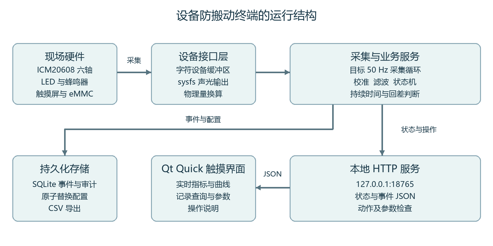
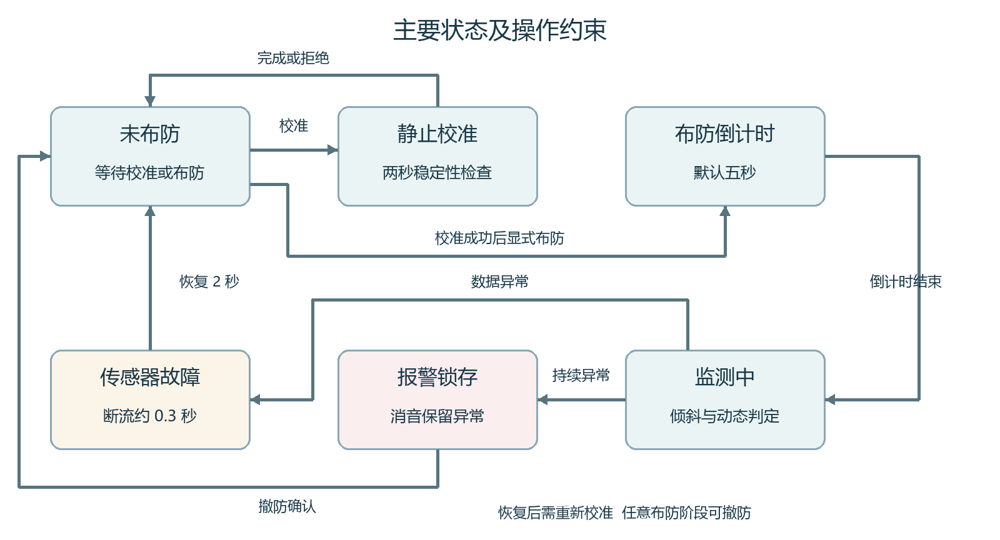
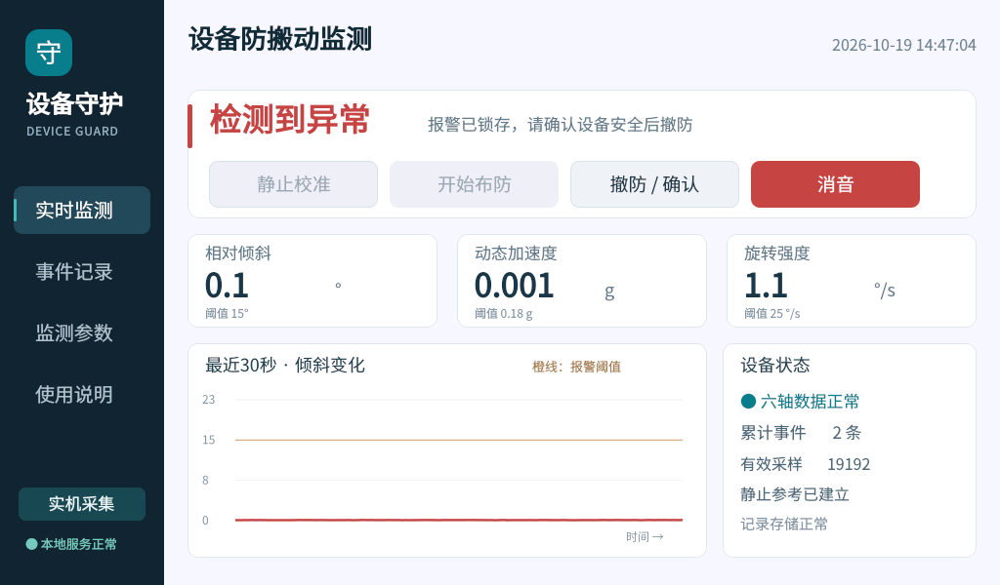
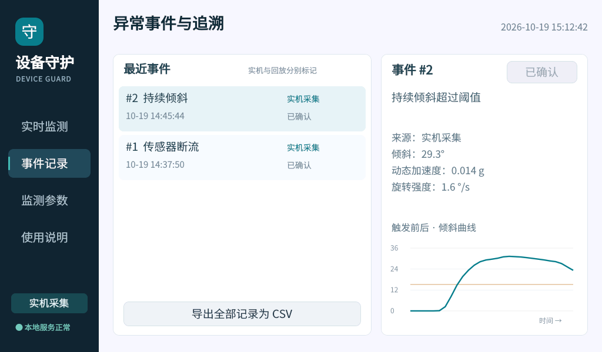

# 设备防搬动与异常事件记录终端

基于 i.MX6ULL 的嵌入式系统课程设计报告

## 摘要

本课题在正点原子 i.MX6ULL ALPHA 开发板上实现设备防搬动与异常事件记录终端。系统利用板载 ICM20608 六轴传感器采集加速度和角速度，通过静止校准建立设备当前放置姿态的参考向量，结合低通滤波、相对倾斜计算、持续时间判定与回差，区分短暂碰动和持续异常。Qt Quick 触摸界面提供实时监测、记录查询、参数设置和操作说明，Python 服务完成状态管理、声光控制和 SQLite 数据保存。事件记录包含来源、触发原因、当时指标以及触发前后的趋势数据，并可导出为 CSV。

系统已在 eMMC 版本开发板和七寸 RGB 屏上运行。实机静止校准与布防成功，用户实际倾斜开发板后触发报警，触发记录中的相对倾斜角为29.29°，触摸操作得到确认。另以明确标记的回放输入验证短碰过滤、持续倾斜、传感器断流和恢复等分支。确定性逻辑与存储测试共14项通过，端到端检查17项通过，结果随工程证据文件保存。后续增加统一主题的单页桌面、侧边三键导航和真实后台驻留；整板软件重启后，侧栏与16图标布局均保留。声音由参数页控制，系统升级保留原有设置。本报告依据2026年10月19日至21日保存的实测记录与当前源码撰写，2026年10月31日整理定稿，没有把整理日期当成新的硬件测试日期。

关键词  嵌入式 Linux  i.MX6ULL  ICM20608  Qt Quick  异常事件记录

## 1 项目目标与需求

### 1.1 选题背景

实验室仪器、展台样机和固定摆放的设备在使用过程中，可能发生未经确认的搬动、姿态改变或碰撞。单纯显示传感器数值只能回答设备此刻的状态，无法回答何时出现异常、异常是否持续、操作者是否确认。课程项目因此围绕“感知状态、判断异常、提示处理、留下记录”组织完整流程，把传感器读数转化为可操作、可追溯的终端功能。

本课题采用开发板已有的六轴传感器、触摸屏、LED 和蜂鸣器，不依赖摄像头，也不要求额外购买温湿度或振动模块。七寸屏用于现场操作，eMMC 用于保存配置和事件。网络连接承担部署、调试与文件取回，监测程序启动以后在本机运行，判断过程不依赖电脑持续发送指令。这样的选题与现有硬件匹配，也给独立完成的课程设计留下算法、界面、系统适配和验证等具体工作。

### 1.2 功能需求

系统首先应能读取真实六轴数据并判断数据是否有效。操作者将设备放稳后执行静止校准，校准成功才允许布防。布防时保留倒计时，给操作者离开设备或结束操作的时间。监测中持续倾斜、持续旋转或动态加速度异常达到设定条件时，系统进入锁存报警状态，避免设备恢复原位后异常提示立即消失。

报警处理需要区分关闭声音与解除布防。消音只改变声音输出，不删除事件，也不取消红色报警；撤防表示操作者确认当前情况并结束本次监测。参数页面允许修改角度、动态加速度、旋转强度、持续时间和倒计时，配置应在重启后保留。修改参数仅在未布防时允许，防止监测过程中出现阈值突然改变而难以解释的行为。

记录功能应保存事件时间、类型、来源、原因、关键数值和确认状态。为了说明触发前后发生了什么，事件还保存触发前约三秒及触发后约三秒的低频趋势点。界面应能查询最近记录并查看曲线，CSV 应使用常见表格软件可以识别的中文编码。设备数据中断时需要明确提示故障；恢复后回到未布防状态，要求重新校准，避免把数据恢复直接视为设备已安全。

### 1.3 非功能需求与完成范围

界面按1024×600像素设计，按钮尺寸适合手指点击，主要状态以文字和颜色共同表达。采集循环目标周期为20毫秒，采用单调时钟计算持续时间，不把普通 Linux 用户态任务当成硬实时任务。采样频率可能受绘图、数据库及系统调度影响，测试中记录实际频率，报警持续时间也按实际时间推进。

课程原有驱动和厂商桌面属于复用基础，本工程新增传感器适配层、状态机、事件数据库、HTTP 本地服务、Qt Quick 界面及测试工具。工程不重新实现 Linux 内核、引导程序或传感器底层 SPI 驱动。报告将复用内容与新增内容分别说明，评价重点放在应用系统的集成质量和可验证行为上。

## 2 开发平台与总体方案

### 2.1 实际平台

实机采用 i.MX6ULL ARMv7 平台，运行 Linux 4.1.15 系列内核，根文件系统位于 eMMC 的 /dev/mmcblk1p2。可用内存约494 MB，根分区约7.1 GB，检查时剩余空间约6.1 GB。屏幕帧缓冲为1024×600、16位 RGB565，显示设备为 /dev/fb0，触摸设备为 goodix-ts 对应的 /dev/input/event1。

软件环境包含 Qt 5.12.9、qmlscene、Python 3.5 和系统 SQLite 动态库。镜像中的 Python 没有 sqlite3 标准扩展模块，也没有 PyQt、PySide 等绑定。若直接使用桌面电脑上的 Python GUI 方案，会在开发板上遇到依赖缺失。最终方案使用 Qt Quick 显示界面、Python提供设备服务，并通过回环地址上的HTTP交换JSON。启动与桌面管理采用原生C程序；板端已有Qt宿主可用于快速显示，没有独立宿主时也支持qmlscene。这样不需要在目标板安装PyQt或完整桌面浏览器。

| 部件 | 已核对的接口 | 在本系统中的用途 |
| --- | --- | --- |
| ICM20608 | /dev/icm20608  SPI设备 | 加速度和角速度采集 |
| RGB 显示屏 | /dev/fb0  1024×600 | 本地状态与曲线显示 |
| 电容触摸 | /dev/input/event1 | 校准 布防 参数及记录操作 |
| 状态灯 | /sys/class/leds/sys-led | 布防和异常闪烁提示 |
| 蜂鸣器 | /sys/class/leds/beep | 可选择开启的声音报警 |
| eMMC | /opt/device_guard/data | 配置和事件持久化 |
| 有线网络 | eth0或实际联网接口 | 部署 调试 取回记录 本地监测不依赖联网 |

### 2.2 系统结构

系统分为硬件接口、采集与业务、数据存储和触摸显示四个部分。硬件接口把驱动提供的整数转换为统一物理量；业务层维护滤波结果和状态机；存储层持久保存异常事件及操作审计；界面读取状态并提交操作。界面进程不直接访问传感器，状态机也不包含 Qt 相关代码，因此逻辑可以脱离屏幕进行确定性测试。

启动器先检查设备节点，必要时加载镜像自带的ICM20608模块，再并行启动本地服务和Qt界面。前台监测时暂时暂停厂商图形进程，防止多个程序争用帧缓冲；回主页时隐藏监测窗口并恢复桌面，采集服务继续运行。完全退出时结束子进程、关闭本项目输出并恢复桌面。主程序独立部署到 /opt/device_guard；后续系统主题对桌面入口、应用QML入口和配置做可回退修改，没有修改U-Boot、BOOT拨码和Linux内核。

### 2.3 本地接口设计

服务仅监听127.0.0.1:18765。界面通过 GET /api/state 获取状态，通过 POST /api/action 发起校准、布防、撤防或消音，通过 /api/events 和 /api/event 获取记录。配置接口验证字段和范围，未知字段、非数值、NaN 或越界数据都会被拒绝。回放接口只在显式回放模式启用，真实采集模式拒绝注入回放场景。

这种进程划分适合当前缺少 Python Qt 绑定的镜像。代价是 JSON 序列化和轮询占用额外资源，所以趋势点只以约5 Hz保存，界面以125毫秒间隔请求状态，不把每个原始采样点都发送给屏幕。服务的数据源和界面左侧来源标记保持一致，真实事件与人工构造的回放结果可以被区分。

## 3 硬件接口与运行环境适配

### 3.1 六轴数据读取

配套驱动每次组织七个有符号32位整数，顺序为三轴角速度、三轴加速度和温度原始值。参考驱动把陀螺仪量程设置为±2000°/s，把加速度量程设置为±16 g。因此应用分别使用16.4 LSB/(°/s)和2048 LSB/g进行换算。这里的量程是针对所核对的驱动配置，若更换驱动或修改寄存器，必须同步修改换算系数。

调试中发现该驱动执行 copy_to_user 后固定返回0，没有按常规 read 约定返回28字节。直接调用 Python 的 os.read 会得到空字节，虽然驱动实际已经写入用户缓冲区。应用因此用 ctypes 调用 libc.read，并预先把七个位置填入哨兵值。读取后检查返回值是否为负、缓冲区是否完整写入，再进行换算。这样既适配当前驱动，也能发现缓冲区未写完的异常。

更规范的长期方案是在有完整内核构建环境时修正驱动返回值，并处理 copy_to_user 失败。本课程工程保留原装模块，通过独立适配层解决当前运行问题，避免为应用验证而直接替换正在使用的内核。适配层的假设和限制写入代码注释，使后续维护能够找到这一特殊行为。

### 3.2 声光输出

状态灯和蜂鸣器通过 LED 类 sysfs 节点控制。程序启动时记录原有 brightness 和 trigger，运行中将 trigger 设为 none，由状态机控制闪烁。布防时状态灯慢闪，报警或故障时快闪。声音开启且没有消音时，蜂鸣器按短促的双脉冲节奏提示，避免用一个长时间高电平代替可辨认的报警节奏。

本次实机联调中蜂鸣器已确认能够发声，随后根据使用者要求关闭声音并保存配置。交付版本默认关闭声音，回放启动器还会禁用真实指示器输出。是否有声音不影响报警锁存、事件保存或红色状态提示。正常退出时蜂鸣器被置为0，原有状态灯触发器恢复。

### 3.3 时间与依赖适配

开发板最初的系统时间停留在旧日期，若直接使用，将得到错误的事件时间。本次部署根据电脑 UTC 时间同步开发板系统时钟，应用使用 POSIX 时区 CST-8 显示北京时间。采用这一时区表达式，是因为精简根文件系统可能没有 Asia/Shanghai 所需的 zoneinfo 文件。持续时间使用 time.monotonic，系统时钟校正不会直接改变已经进行的倒计时。

SQLite 适配首先尝试 Python 标准模块；在本板缺少该模块时，通过 ctypes 调用已有 libsqlite3。适配器使用参数绑定处理中文、引号、浮点数与空值，不通过拼接 SQL 插入用户数据。每条语句完成后释放预处理对象，数据库设置忙等待时间并启用 WAL，以支持服务线程和请求线程之间的访问。

## 4 检测算法与状态机

### 4.1 静止校准

校准持续两秒，采集这一时间段内的加速度与角速度。应用计算各加速度轴的均值及标准差，只有三轴最大标准差小于0.03 g、期间角速度模长小于8°/s、平均加速度模长位于0.7至1.3 g之间，才接受校准。均值向量作为当前姿态的参考重力方向。若检测到运动，校准被拒绝，操作者需要放稳后重试。

这种处理允许设备以不同角度固定放置，不要求开发板必须水平。参考向量在当前程序会话中有效，程序重启后重新校准，避免沿用已经发生位置变化的旧参考。校准验证的是短时间稳定性，没有完成精密六面标定或温漂补偿，不能把它解释为传感器精度校准。

### 4.2 重力估计与相对倾斜

加速度读数同时含有重力和运动分量。应用使用一阶低通滤波估计缓慢变化的重力向量，时间常数取0.25秒。滤波系数根据本轮实际采样间隔计算，因此循环略有抖动时，滤波时间尺度仍与真实时间接近。

$$\alpha_k=1-e^{-\Delta t_k/0.25},\qquad \mathbf g_k=(1-\alpha_k)\mathbf g_{k-1}+\alpha_k\mathbf a_k$$

式中 a 表示当前加速度，g 表示滤波得到的重力估计，Δt 为相邻有效样本间隔。算法随后计算重力估计与校准向量 b 的夹角，并把余弦值限制在负一到一之间，防止浮点误差导致反余弦计算失败。

$$\theta_k=\arccos\!\left(\operatorname{clip}\!\left(\frac{\mathbf g_k\cdot\mathbf b}{\|\mathbf g_k\|\|\mathbf b\|},-1,1\right)\right)\frac{180}{\pi}$$

夹角对偏离参考重力方向的倾斜较敏感。由于只依靠重力向量，设备绕重力方向旋转时夹角可能很小，因此系统还使用陀螺仪模长补充旋转检测。这里没有对陀螺仪积分重建完整三维姿态，避免将短时运动检测扩大为没有充分验证的姿态导航系统。

### 4.3 动态加速度与旋转强度

动态加速度指标取加速度向量与低通重力估计之差的模长，角速度指标取三轴角速度的欧氏模长。这样不需要预先指定设备最容易被搬动的方向，任意轴的明显变化都可以参与判断。

$$d_k=\|\mathbf a_k-\mathbf g_k\|,\qquad \omega_k=\sqrt{\omega_x^2+\omega_y^2+\omega_z^2}$$

默认相对倾斜阈值15°，持续1200毫秒；动态加速度阈值0.18 g，角速度阈值25°/s，任意一种运动指标达到条件并持续800毫秒触发搬动报警。阈值用于本次课程实机验证，不能直接解释为适合所有设备和安装方式的通用参数。设备更重、安装更软或周围振动更强时，需要重新观察正常波动并调整。

### 4.4 持续时间与回差

超过进入阈值后，算法启动对应计时。指标降低到进入阈值的70%以下才复位计时；处于70%至100%的回差区间时保留当前判定。持续时间与回差共同减少临界抖动造成的频繁开始和取消。对于搬动条件，动态加速度和角速度都回到各自复位阈值以下才结束该次运动候选。

短暂碰动测试采用持续约0.1秒的突变，随后恢复静止，间隔足够让计时复位。多次分离的短碰不会累积成一次长异常。严格地说，计时规则是进入异常候选后没有降到复位阈值的持续时间，并非要求每个采样点都高于进入阈值；这一细节应与代码和报告一致。

### 4.5 状态转移与故障恢复

系统包含未布防、校准、布防倒计时、监测、报警和传感器故障六种状态。任何监测会话都由操作者显式布防。报警一旦触发便锁存，设备放回原位仍显示异常，直到撤防确认。这样能够保留短时间出现后又消失的现场情况。

数据连续异常约0.3秒时，未处于报警锁存的系统进入故障状态并记录断流。有效数据连续恢复两秒后转到未布防状态，并清除参考向量，要求重新校准。已经锁存的报警保持其主要状态，同时界面仍会显示传感器是否正常。恢复数据不自动恢复布防，避免在参考姿态和异常原因尚未确认时静默继续监测。

## 5 数据保存与异常追溯

### 5.1 数据表与记录内容

events 表使用自增事件编号，保存 created、kind、source、reason、angle、motion、gyro、acknowledged 和 samples。created 是墙上时钟时间戳，便于转为可读日期；source 为 hardware 或 replay，用于区分真实传感器和回放；samples 是趋势点的 JSON 数组。audit 表单独保存启动、停止、校准、参数修改和操作，避免把每次点击都当成一次异常事件。

事件列表显示最近200条记录，界面状态摘要显示最近8条并给出总数量；CSV 导出查询全部事件。因此列表数量限制只影响屏幕浏览范围，不会自动删除较早数据。当前版本没有后台清理策略，长期使用需要补充容量管理，课程验证的数据量不会据此推导无限期运行能力。

### 5.2 触发前后窗口

服务在内存中保存约三十秒的降采样趋势。触发时先把之前约三秒的数据与事件基本信息写入数据库，再继续收集之后三秒，最后更新该事件的完整曲线。先写基本记录可以让触发事件及时出现，后续曲线则逐步完成。若程序正常退出时窗口尚未结束，退出流程会保存已经采集到的部分。

单个趋势点保存运行相对时间、单调时间、角度、动态加速度和旋转强度。界面绘制角度趋势，数据库保留另外两种指标供进一步分析。当前结构不是全速原始波形记录器，约5 Hz的趋势数据足以解释持续异常的过程，但无法代替高频振动频谱分析。

### 5.3 配置和导出

配置先写到临时文件，flush 与 fsync 后再用 os.replace 替换原文件，减少正常写入中断时出现半份 JSON 的机会。读取配置失败时使用默认值；配置内容也会再次经过范围校验。事件写入使用 SQLite 自身的持久化机制，测试验证的是正常关闭与重新打开后数据保留，没有进行反复断电破坏试验。

CSV 使用 UTF-8 BOM，列名包含事件编号、时间、类型、来源、原因及物理量单位，避免只输出没有含义的数字。导出文件保存在当前模式数据目录的 exports 子目录。实机与回放各用独立数据目录，即使同时运行端到端测试，也不会把构造的异常写入正式实机记录。

## 6 触摸界面设计与操作

### 6.1 实时监测

实时页采用触摸HUD布局，左侧为监测、记录、参数和说明，中心显示状态圆环、操作按钮和三个物理量，底部显示约三十秒趋势，右侧保留人物背景与设备状态。未校准时布防按钮不可用，布防或报警时校准按钮不可用。操作限制与服务端状态检查同时存在，避免仅靠按钮置灰维持业务约束。

图3为早期功能版的真实帧缓冲截图，保留它用于对应当时的物理倾斜事件；最终HUD外观另见图6。图中标记实机采集。开发板放回桌面后实时角度已接近零，但上方仍保持红色报警；实际触发数值保存在事件详情中。这一画面说明当前实时值与已经发生的异常记录具有不同含义，不能用恢复后的数值覆盖触发时的证据。

### 6.2 事件记录与参数设置

事件页面左侧按新到旧显示记录，右侧展示选中事件的原因、物理量和触发前后曲线。记录的来源和确认状态均直接显示。历史事件可在重启后通过确认记录按钮确认，确认记录不会单独解除当前报警。参数页把六种主要数值参数与声音开关放在同一屏，采用加减按钮和明确单位，保存成功后给出提示。报警或布防期间要求先撤防再修改，以保持同一监测会话的判定标准稳定。

说明页给出放稳、校准、布防、确认和导出的操作步骤，并提供退出到原桌面的按钮。回放模式下额外显示静止、短碰、倾斜、搬动和断流场景按钮，来源标记持续显示回放测试。这样可以在不反复拿起开发板的情况下展示异常分支，同时保留数据来源的可辨认性。

### 6.3 最终HUD与统一系统导航

后续界面把设备守护启动图标、系统图标和桌面壁纸统一为酒红、象牙白与金色主题。美术统一只承担辨认应用和组织界面的作用，传感器异常仍用明确状态文字、数值和高对比颜色提示，不把装饰效果作为判断依据。HUD底图来自用户提供的游戏画面，生成图标和桌面背景另有素材记录，均在来源说明中区分。

原厂应用使用浮动返回球，退出方式不统一，主页还有两个分页。最终桌面把16个应用排为4×4网格，时钟、记事本、仪表盘和文件移至第四行，删除底栏和空白第二页。右侧固定72像素导航区，提供返回、主页和任务。应用原有1024×600内容等比例缩放到左侧952像素，Qt同时映射触摸坐标，避免只缩图而点击位置不匹配。

返回键优先关闭任务面板或输入法，然后处理应用内部层级；文件管理器返回父目录，相册返回图片列表，设备守护从参数页返回监测页。主页键隐藏窗口并保留进程与页面。桌面任务页将后台驻留项与最近使用项分别标注，前者恢复原进程，后者重新启动，避免把历史记录误称为后台。需要释放内存时由操作者点击结束，记事本先调用原保存流程，设备守护则正常关闭采集。

### 6.4 后台采集与桌面进程协作

对监测终端而言，回主页不应等于停止监测。普通厂商应用通过现有通信接口隐藏与恢复；设备守护另用本地任务命令通道控制前后台。C启动器收到后台请求后恢复先前暂停的桌面进程，界面隐藏，Python采集线程继续运行。恢复前台时重新协调帧缓冲使用权，再显示原Qt窗口。这样页面状态与业务状态都留在原进程中，不需要重新校准来伪装一次恢复。

后台只指同次开机内的进程驻留。程序完全结束或开发板断电后，内存中的界面和参考姿态不继续存在；持久化的配置与事件由文件和SQLite恢复。后台界面停止高频状态刷新，任务命令采用长连接等待，减少无意义轮询。开发板内存有限，可用内存不足96MiB时拒绝新开应用并提示手动结束不用的任务，不自动丢弃已有页面。

## 7 测试方法与结果

### 7.1 测试分层

第一层为确定性测试，用人为推进的单调时间和可复现向量输入检查状态机。它不依赖实际触摸节奏，能够精确覆盖短碰、持续异常、倒计时和故障恢复。第二层在真实开发板上启动独立端口的回放服务，连同 HTTP、线程、SQLite 和配置文件一起验证。第三层为真实传感器、屏幕、触摸和输出验证，要求操作者实际倾斜开发板。

这种分层避免把算法测试与真实硬件能力混为一谈。例如回放断流能验证业务状态恢复，并不证明反复拔插硬件接口的电气行为；真实倾斜能够证明该板传感器与检测流程连通，但单次成功不能说明任意搬动方式都可被识别。测试证据以 JSON、截图和测试日志保存在 evidence 目录，结论按证据范围表述。

| 检查对象 | 输入或操作 | 观察结果与证据 |
| --- | --- | --- |
| 逻辑与持久化 | 确定性测试及临时数据库 | 14项通过 包含中文和原生 SQLite 适配 |
| 实机校准与静止 | 真实六轴输入 校准后布防 | 校准成功 静止观察期间保持监测 |
| 实机倾斜 | 操作者倾斜并保持 | 红色报警 记录倾斜29.29° |
| 实机触摸与声音 | 操作者触摸并确认发声 | 触摸正常 声音可用 开关设置按实机配置保留 |
| 本地服务全流程 | 明确标记的回放输入 | 见 integration_check.json 全部检查通过 |
| 正常退出与重启 | 停止服务后重新启动 | 事件及参数保留 重新校准后布防 |

### 7.2 实机数据与运行频率

真实静止采集时，加速度主要集中在 z 轴，模长接近1 g，角速度模长约1°/s，符合放置在桌面的现象。校准完成后相对角度约0.02°，动态加速度约0.001 g。用户倾斜开发板后产生的事件编号为2，触发时角度29.29°，动态加速度0.014 g，旋转强度1.59°/s，类型为持续倾斜。较低的动态加速度和角速度说明事件是在倾斜保持阶段达到持续时间条件。

在运行界面与本地服务的观察窗口中，实测有效采样频率约42.3 Hz，该窗口没有新增采集错误。目标50 Hz与实测值存在差异，原因包括普通 Linux 调度、Python执行、图形渲染及接口请求开销。因此系统按真实单调时间计算持续条件，不用固定样本数量乘以20毫秒代替时间。该结果只代表本次环境与观察窗口，不能作为系统在其他负载下的频率保证。

### 7.3 故障发现与修正

首次启动真实服务时没有发现 /dev/icm20608，系统进入故障状态并保存事件编号1。检查发现原装驱动模块仍位于 /home/root/driver/icm20608，重启后没有自动加载。手工加载后数据恢复，启动器增加缺少节点时加载原装模块的步骤。保留这条故障记录，是因为它反映了真实发生过的系统适配问题。

另一个问题是驱动读取返回0，以及 Python 缺少 sqlite3 扩展。这两项分别通过缓冲区适配和动态库接口解决。端到端检查还暴露出测试等待时间不足：检查事件曲线时尚未完成触发后的三秒窗口，随后按完整窗口等待再检查。这里修正的是测试观察时刻，未为了让测试通过而缩短记录窗口。

### 7.4 验证范围

已完成的实机验证覆盖当前开发板上的静止采集、校准、倾斜触发、触摸交互、声光接口和正常重启数据保留。持续旋转、重复短碰及断流恢复还通过确定性和回放测试覆盖。尚未建立大规模多设备数据集，没有计算准确率、召回率或长期误报率，也没有开展断电一致性和温度范围试验。

### 7.5 启动与桌面性能测试

性能测试从真实evdev点击开始计时，使用帧缓冲变化判断首屏，以界面收到有效状态的日志判断数据就绪。2026年10月19日，同次开机内的三次HUD测量中，首屏分别为2.883、2.862和2.876秒，界面收到真实数据分别为3.840、3.822和3.804秒。结果对应当时的原生启动器与HUD版本，不能直接当成后来所有版本的冷启动保证。

桌面主题首版采用另一组同次开机、相同方法的两次前后对照。改造前首屏为1.889和1.855秒，RSS为43452和43752KiB；改造后首屏为1.412和1.410秒，RSS为33696和33776KiB。平均首屏减少约24.6%，桌面进程RSS减少约22.6%。优化包括去掉模糊面板、遮罩和空分页，使用显示尺寸图标与壁纸，并以原生C任务服务替代额外常驻图形层。

上述指标衡量桌面首屏和该进程驻留内存，没有测量所有应用帧率。第二版新增真实多应用后台，总内存会随应用数量变化，也不能把首版进程RSS直接描述成第二版整机内存。报告保留测试方法、版本和原始JSON，避免只引用较快数字而忽略测量条件。

### 7.6 开机缓存故障及整板重启验证

首版曾出现手动重载正常、重新开机却丢失侧栏并出现空白页的问题。现场检查发现，开机环境的HOME为根目录，手动调试时HOME为用户目录，两处存在不同的Qt磁盘缓存。由于修改过的资源沿用厂商固定资源时间，开机仍可能接受旧的主QML缓存。仅验证桌面进程重启没有覆盖这一环境差异。

修复后由桌面入口统一设置独立XDG缓存目录，原厂应用继承相同环境，隔离旧缓存；没有通过删除用户目录的所有缓存来掩盖问题。实际执行同步并整板软件重启，以Linux启动编号变化确认内核重新启动，而非仅更换桌面PID。重启后16图标网格和侧栏的选定帧缓冲区域与重启前逐字节一致，左右滑动后仍一致，底栏和第二页配置为空。

这一检查明确验证整板软件重启；没有把它写成多次拔电、文件系统损坏恢复或长期无人值守试验。时钟也属于结果解释的一部分：部分板端截图显示镜像旧时间，截图日期不能直接当作实际测试日期；这里的测试批次依据保存的工程记录与操作记录确定。

### 7.7 后台留存与正常结束验证

实机同时打开文件管理器、记事本和设备守护。文件管理器进入子目录后回主页，再切到记事本并返回，仍复用原PID，目录区域帧缓冲逐字节相同。记事本打开空白编辑页后回主页，再打开仍为同一进程和编辑页。测试没有通过重新打开默认首页来代替页面恢复。

设备守护切至参数页后回主页，保存记录中的启动器PID和界面PID保持不变，采集计数从5240增长到5333；重新打开后恢复前台及原参数页。该计数用于证明后台仍采集，不据此计算精确采样率，因为没有为这两个计数保存严格对应的完整时间区间。最终桌面任务页结束应用后，PID消失，列表自动由后台驻留改为最近使用。整板重启后再次验证LED应用驻留与结束，确认开机后的应用也使用新导航。

## 8 部署复现与文件说明

工程src目录中，guard/engine.py实现状态机，hardware.py适配真实与回放输入，service.py组织采集，storage.py与sqlite_compat.py实现存储，run.py提供本地HTTP服务。Qt界面在ui目录，fast_launcher.c协调后台与显示进程。tests保存确定性测试，tools保存打包、检查和数据备份工具，system_desktop/theme_v1保存桌面主题、导航、任务服务及版本恢复脚本。

在具有Python和SQLite动态库的Linux环境中，可运行python3 tests/test_engine.py复现逻辑与存储测试。ARM启动器使用交叉GCC构建，不要求在开发板安装编译器。程序部署在独立目录，配置与真实数据库不随源码覆盖；复制运行中的数据库应通过SQLite备份接口完成，避免遗漏WAL内容。

板端启动入口为python3 /opt/device_guard/launcher.py，回放时增加--replay。图标启动同样进入原生启动器。最终系统桌面随原厂开机入口加载，但设备守护不会在没有操作者选择的情况下自动布防。侧边主页保留后台采集，左下角电源键或桌面任务页结束才会停止程序。不能把隐藏窗口等同于关闭监测服务。

网络只用于部署与取回材料，应读取开发板和电脑的实际接口地址。历史连接用过静态IPv4与IPv6链路地址，接口编号可能随电脑重启变化，报告不把某个临时地址写成硬件的固定属性。独立采集与异常判定在板端回环服务中完成，拔掉网线不需要改写检测算法。

系统主题采用安装前校验、原文件与指定缓存备份、原子替换和恢复清单。恢复前核对当前文件仍是本版本，遇到后续编辑即停止，避免把新工作覆盖掉。第二版保存21项回退变更，最终55项运行文件与本地构建文件一致。原厂驱动、程序和用户运行数据各有明确边界，不能用无差别覆盖系统目录作为升级方法。

交付包括带学校封面的报告、单独TXT自评、必要演示视频及工程说明。视频小于50MB，内容对应早期实机与回放批次，不声称覆盖后来所有桌面改动；新增导航与整板重启由对应截图、JSON和测试脚本补充。公开仓库不放个人信息、连接凭据或真实运行数据库，也不分发厂商原始二进制；需要这些文件的主题重建步骤明确说明由本机合法取得。

## 9 工作内容与创新点

本课题的微创新体现在围绕设备现场状态组织完整业务。相对于独立传感器读数示例，增加静止参考姿态、带持续时间与回差的判定、报警锁存和确认、故障恢复要求、触发前后记录，以及可区分来源的回放验证。上述功能互相约束，形成从采集到追溯的闭环，而不是把几个演示窗口并排放置。

硬件关联性来自实际访问 SPI 传感器字符设备、Linux 输入与帧缓冲、LED 类节点和 eMMC 文件系统。软件工作包括适配旧驱动和精简 Python 环境、建立状态机、设计触摸界面、数据库与配置文件处理、启动恢复以及测试。本项目按独立完成形式组织，不虚构多人分工。实际工作覆盖硬件适配、检测逻辑、存储、界面、原生进程管理、系统主题、测试和材料整理；姓名、学号、班级和指导教师留待填写。

复用边界应明确：Linux 内核、Qt、Python、SQLite 及厂商 ICM20608 内核模块属于现有基础；工程没有宣称重新开发这些组件。新增代码集中在应用层和系统集成。报告中的截图来自真实屏幕，回放数据在界面和数据库中均标明来源；实机物理倾斜结果与回放覆盖的异常分支分别列出。

系统部分的新增工作还包括真正的后台驻留与开机环境修复。判断难点在于监测服务、Qt窗口和厂商桌面分别属于不同进程，隐藏窗口并不代表后台逻辑一定继续，保留最近图标也不代表进程还在。因此验证同时查看PID、采集计数与页面画面，而不是仅凭任务列表文字判断。这些约束使系统集成形成实际工作量，而不仅是替换图标。

本设计使用了AI工具辅助代码实现、素材生成、调试分析和文档整理，复用厂商驱动及程序时保留来源。课程评价应围绕实际实现、对代码的理解和可复现证据，不把现有内核、Qt库、厂商程序或游戏画面列作自主底层研发。公开源码与报告均说明复用边界。

## 10 认识与改进方向

本项目说明，嵌入式程序是否可用往往取决于接口约定和运行环境，而不只取决于算法公式。驱动返回值、模块加载路径、时区文件、Python扩展和图形进程管理都可能使电脑上能够运行的程序在板上失败。将这些差异限制在接口层，并保留运行证据，能够让问题更容易定位，也避免在多处重复加入针对某一镜像的特殊处理。

状态机使操作顺序可以被检查。校准未完成不能布防，故障恢复不能自动布防，消音不会把报警变成正常，参数改变需要先撤防。每个规则都对应实际界面行为与测试。相比只在循环中判断某个数值是否超限，这种结构更适合解释完整系统，也让后续增加权限验证、外部告警或新的异常指标时有明确位置可改。

本系统利用加速度和角速度感知姿态与动态变化，不能直接测量绝对位置。保持姿态的缓慢平移、匀速移动或很轻的动作可能不足以触发当前阈值；重力方向附近的慢速旋转也有检测局限。若要获得更强的防搬走能力，需要结合固定底座开关、外部定位或安装结构，而不能把一块六轴传感器等同于完整安防系统。

当前课程版本也没有加入操作者身份校验、独立后备电源或断电上传。因此更准确的定位是可现场操作、可追溯的设备状态监测终端。进一步工作可优先补充基于正常环境数据的阈值整定、数据库容量管理、时间源校验和更长时间稳定性实验。在完成这些验证以前，不使用“零误报”或“全天候可靠”等超出证据的结论。

### 10.1 设计过程的认识

在本设计中，我对“完整嵌入式系统”的理解不再停留在点亮屏幕和读出一组数值。设备出现异常后，用户需要知道发生了什么、是否需要处理、处理后记录是否保留。因此界面、状态机和数据库必须围绕同一事件协作。将这些行为写成明确状态与操作约束，比在主循环中不断增加条件更容易验证，也更便于在答辩时解释每一个按钮为什么可用或不可用。

驱动适配让我认识到，接口说明与真实行为必须同时检查。这里不能仅凭read返回0就断定没有数据，也不能因为缓冲区里存在数字就判断它们一定有效。先用哨兵检测完整写入，再按厂商量程换算，是把接口差异限制在底层适配中的做法。以后遇到不同镜像或硬件版本，也应先确认数据布局与单位，再讨论上层算法参数。

校准和持续条件说明了参数与场景之间的关系。15度阈值本身并不保证合理：设备当前摆放方式、操作中的短碰、滤波延迟和保持时间都会影响结果。相对姿态参考让不同摆放方向可以统一描述，回差减少阈值附近反复计时。但长时间误报统计没有完成，就不能仅凭一次倾斜成功断言系统已经可靠识别全部搬动方式。

界面优化也改变了我的验证思路。首屏更快是可以测量的目标，但减少启动时间不等于提高所有场景的帧率。后台驻留让用户回到原页面更快，却占用更多内存，因此需要任务结束入口与可解释的内存限制。把这些取舍写清楚，比只保留“速度提升”的结论更符合工程实际。

### 10.2 测试与复现的认识

开机缓存问题说明，测试环境本身也是系统的一部分。相同程序在手动命令和开机脚本中可能拥有不同的HOME、缓存位置和环境变量。最初只重载桌面进程没有发现问题，后续用启动编号确认整板重启，并比较真实帧缓冲，才把“看起来修好了”变为有依据的结论。以后设计测试时，应把启动方式、版本和前置状态与输入数据一起记录。

数据管理方面，我认识到源码回退与运行数据恢复应分开。工程升级不能为了方便而覆盖已经产生的事件；SQLite存在WAL时，直接复制单个数据库文件也未必得到完整备份。保留配置校验、备份接口和恢复前哈希检查，有助于在继续修改功能时维护已有结果，而不是每次调试都从空白环境重新开始。

本项目仍有明确改进空间。首先应收集更长时间的正常场景数据，统计阈值与误报之间的关系；其次应测试不同安装方向与动作速度，建立更系统的边界样例；还应加入数据库容量管理和可信时间同步。若需要真正的防盗用途，还必须考虑身份校验、断电后备和外部定位，不能把课程级姿态监测直接当成完整安防产品。

## 11 项目自评

本课题基于i.MX6ULL ALPHA开发板设计了设备防搬动与异常事件记录终端。系统由ICM20608六轴采集、异常判定、Qt触摸界面、声光输出、SQLite记录和原生进程管理等部分组成，实现静止校准、倒计时布防、持续倾斜与搬动判定、报警锁存与确认、故障恢复、记录查询和CSV导出，并增加统一主题桌面、侧边三键导航及真实后台驻留。项目应用了嵌入式Linux设备文件、sysfs、帧缓冲与输入接口、进程通信、状态机和数据库等知识。

选题创新属于应用层微创新，主要体现在参考姿态、持续条件、触发前后追溯及采集与界面的前后台协同，硬件关联明确。项目按独立完成形式组织，工作量覆盖环境适配、算法、存储、界面、系统整合与测试，不虚构小组分工。报告围绕实际源码解释技术路线，以物理倾斜、分层测试、后台进程与整板重启证据支撑结论，说明厂商驱动、现有Qt程序和美术素材的复用来源。实机已验证倾斜报警、触摸、后台继续采集及开机布局保留；长期误报率、拔电一致性与复杂搬动覆盖仍有限。报告结构完整，公式、截图与测试边界较清楚。综合创新性、硬件关联、工作量和报告质量，自评成绩为A。

## 12 参考资料

1  ELIN4120嵌入式系统课程设计要求  课程提供的 DOCX 文件

2  正点原子 I.MX6U嵌入式Linux驱动开发指南V1.81  SPI与ICM20608相关内容

3  配套Linux驱动例程 22_spi 中的 icm20608.c 与 icm20608reg.h

4  TDK InvenSense ICM-20608-G Datasheet Revision 1.0  课程硬件资料目录

5  正点原子 I.MX6U嵌入式Qt开发指南V1.1  Qt运行环境与输入显示接口

6  本工程evidence目录中的实机事件 测试日志与回放验证记录  2026年10月19日

7  本工程system_desktop/theme_v1/evidence中的整板重启 后台驻留与文件核对记录  2026年10月21日

8  本工程src及system_desktop/theme_v1/runtime_src中的实现代码与版本说明  整理日期2026年10月31日
